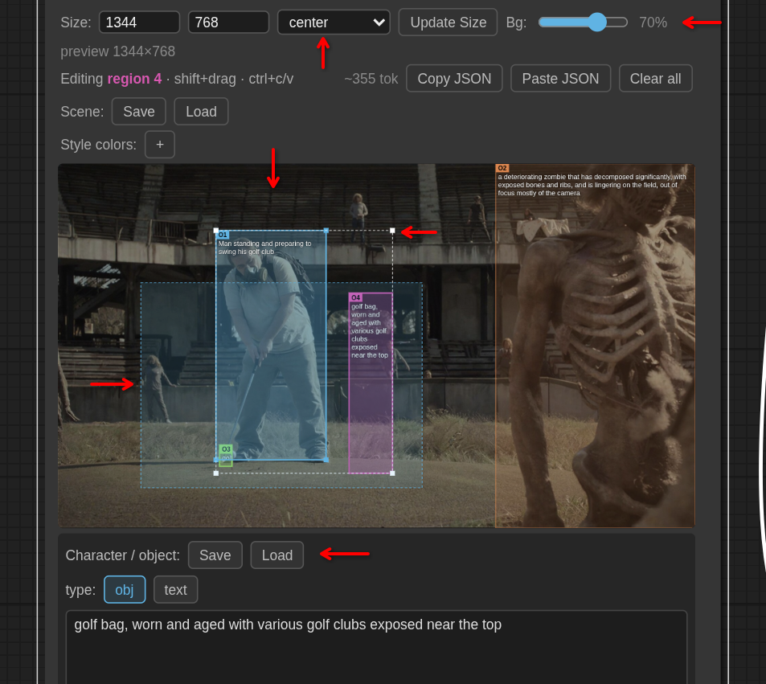

# ComfyUI-ByAE-IdeogramTools

An improved version of [Kijai](https://github.com/kijai)'s excellent **Ideogram 4 Prompt Builder** from [ComfyUI-KJNodes](https://github.com/kijai/ComfyUI-KJNodes). Same node (literally built on top of), replacement drop in, but with workflow and live editor QoL layered on top.

I may add other Ideogram 4 tools here in future, hence the name.



## Nodes

| Node | Role |
|------|------|
| **Ideogram 4 Prompt Builder Pro (based on the KJ node)** | Main visual prompt builder |
| **Ideogram 4 Prompt Builder Pro - Preview BG Update** | Feeds a workflow image into the builder's canvas background |

## Improvements over the KJ builder

- **Character/Object store** — Save, Save As, Load, and Delete named characters/objects
- **Save/Load entire scenes** — save and restore full scenes (boxes, overview, aesthetic, style colors, and the rest); add imported boxes (selected by default) or wipe and replace the entire scene. Delete removes a saved scene
- **Multi-select (Shift+click individual or Shift-drag to select and move/scale them all)** — Shift+drag a selection rectangle; any partially overlapping box is included, the entire selection can be moved around or scaled uniformly on the sides or corners. Shift+click a box to add or remove it from the selection
- **Live background image** — Preview BG Update pushes a workflow image onto the builder canvas; opacity slider blends it over black
- **Copy and paste** — Ctrl+C / Ctrl+V for selected boxes (geometry and field data)
- **Scale mode on resize** — center, corner anchors, or stretch when canvas width/height change. Non-stretch modes scale from the bounding box of your regions and crop unused canvas space when narrowing
- **Paste JSON resize dialog** — when pasting layout JSON, choose how the source canvas was sized (don't care / same / dimensions / aspect ratio) and it will perform content-aware scaling of the pasted regions.
- **Width and height outputs** — separate INT sockets for downstream workflow use
- **Update Size button** — width/height edits apply only when you click Update Size (with chosen scale mode).

## Installation

1. Clone into `ComfyUI/custom_nodes/`:
```bash
# open a terminal in the ComfyUI/custom_nodes directory
git clone https://github.com/by-ae/ComfyUI-ByAE-IdeogramTools.git
```
2. Restart ComfyUI

**ComfyUI-KJNodes does not need to be installed.**

## Usage

After installation, the nodes appear in the node menu under **ByAE/Ideogram**:

1. **Ideogram 4 Prompt Builder Pro** - Add this node to start building your prompt visually
2. **Preview BG Update** (optional) - Connect a workflow image and the builder's `guid` output to display it as the canvas background

The builder outputs a structured JSON prompt compatible with Ideogram 4's API format, plus a preview image showing your layout.

## Troubleshooting

### Nodes don't appear in the menu

- Ensure ComfyUI restarted completely after cloning
- Check the ComfyUI console for import errors
- Verify the folder is named `ComfyUI-ByAE-IdeogramTools` (not `ComfyUI-ByAE-IdeogramTools-main`)
- Make sure you are running a recent version of ComfyUI (the comfy_api module is required)

### "Failed to load stores" or route errors in console

This is usually harmless. The store routes register on startup, and if they fail, character/object/scene save features may not work, but the builder itself will function normally. Check file permissions on your ComfyUI user directory.

Load shows the request error (for example `HTTP 500`) when the store cannot be read. It says there are no saved scenes or characters only when the server returns an empty library. A failed request does not mean the presets were deleted.

**Store location:** Character, object, and scene presets are stored in `<ComfyUI user directory>/byae-ideogram-tools/` as JSON files (`characters.json`, `objects.json`, `scenes.json`).

**Unicode support:** Preset names can include Unicode characters (e.g. 角色, Персонаж, Émilie). Names must start with a letter, number, or underscore, and can contain letters, numbers, spaces, underscores, and hyphens (up to 64 characters).

**Corrupt file recovery:** A leading UTF-8 byte-order mark is ignored and the bucket loads normally. If a store file still cannot be used as a bucket (invalid JSON, or JSON that is not an object), it is moved to a backup named `<bucket>.json.corrupt-<timestamp>` and the bucket is treated as empty. When that backup name already exists, the new file gets an extra suffix so the earlier backup is kept. Other buckets continue to work normally, and saves to the recovered bucket work immediately.

### Failed to save character/object/scene

- Check the browser console (F12) for detailed error messages
- Verify the name meets requirements: starts with letter/number/underscore, contains only letters, numbers, spaces, underscores, or hyphens
- Ensure the ComfyUI user directory is writable
- Try a shorter name (max 64 characters)

### Connected import JSON did not change the prompt

The `import_json` input overrides the editor only when it is a JSON object. A leading UTF-8 byte-order mark is ignored. If the value is empty, not valid JSON, or a JSON array, the node keeps the editor caption and prints a line starting with `[ByAE Ideogram]`.

An object without `compositional_deconstruction` is still used as the prompt. Ideogram 4 requires that object, with a string `background` and a list `elements`. The console says when one of those is missing.

### Background image not updating

- Verify the `guid` output from the builder is connected to Preview BG Update's `guid` input
- Check the ComfyUI console for a line starting with `[ByAE Ideogram BG]`. A failed save names the reason: no image, an empty or invalid guid, an image that could not be converted, or a disk write error
- RGBA frames are composited onto black, and single-channel frames are expanded to RGB, before the file is written. The conversion warning is for a tensor that still cannot be turned into an image
- The temp directory must be writable (usually `ComfyUI/temp`)

### Saved workflows break after updating

Node names and internal IDs are stable. If a workflow breaks, check:
- Width/height inputs are valid numbers (64-16384)
- JSON import input (if used) contains valid JSON
- No custom modifications were made to widget names

For bugs or feature requests, please open an issue on GitHub.

## Development

### Running Tests

```bash
# Install test dependencies
pip install pytest pytest-asyncio aiohttp

# Run all tests
python -m pytest tests/ -v

# Region layout and store-client helpers (no Python dependencies)
node --test tests/*.test.js

# Run specific test file
python -m pytest tests/test_store.py -v
```

### JavaScript Linting

```bash
# Install dependencies
npm install

# Run linter
npm run lint
```

## API

The extension exposes HTTP routes for programmatic access to the character/object/scene store:

- **GET** `/byae/ideogram/stores` — Load all stores (returns `{"characters": {...}, "objects": {...}, "scenes": {...}}`)
- **PUT** `/byae/ideogram/stores/{bucket}/{name}` — Save an entry (body: JSON object; bucket: `characters`, `objects`, or `scenes`)
- **DELETE** `/byae/ideogram/stores/{bucket}/{name}` — Delete an entry (returns 404 if not found, 200 on success)

## License

This project is a derivative work based on **ComfyUI-KJNodes**, in particular `Ideogram4PromptBuilderKJ` and shared frontend utilities.

- Licensed under **GNU General Public License v3.0** — same as [ComfyUI-KJNodes](https://github.com/kijai/ComfyUI-KJNodes). See [LICENSE](LICENSE).
- Copyright for the original Ideogram 4 Prompt Builder and related KJNodes code belongs to [Kijai](https://github.com/kijai) and other KJNodes contributors.
- Enhancements in this repository are provided under the same GPL-3.0 terms. If you distribute this pack, keep the license file and preserve appropriate attribution to Kijai / ComfyUI-KJNodes.
